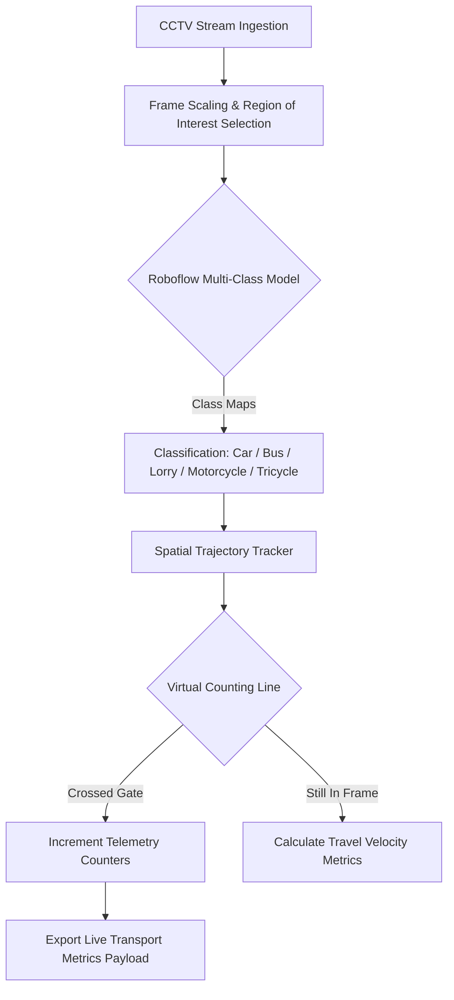

YOLOv8 + DeepSORT: Custom Object Detection & Multi-Object Tracking
End-to-end computer vision pipeline for real-time object detection and multi-object tracking using YOLOv8-Large and DeepSORT, trained on a custom 10-class vehicle dataset.

### System Architecture Flow

---

##  2. Dataset Architecture & Class Engineering (Roboflow)

The machine learning core utilises a highly refined custom model, trained and versioned via **Roboflow**, on a dataset of **852 high-resolution highway images**.

### Targeted Transportation Classes
* **Car**: Standard passenger vehicles and compact personal transports.
* **Bus**: Mass transit and high-capacity multi-passenger vehicles.
* **Lorry**: Light-to-heavy commercial logistics, multi-axle freight carriers, and utility trucks.
* **Motorcycle**: Two-wheeled high-velocity commuters.
* **Tricycle**: Three-wheeled localized urban transport vehicles requiring unique bounding-box aspect ratio tolerances.

### Dataset Management & Optimization Strategies
* **Aspect-Ratio Resilience**: Bounding boxes were meticulously adjusted to prevent small tricycles and motorcycles from being swallowed up or misclassified inside the massive bounding box areas of overlapping commercial lorries.
* **Environmental Augmentations**: Applied exposure adjustments and salt-and-pepper noise injections across the 852 base frames to ensure high classification stability during rain storms, severe highway sun glare, and headlights during night operations.
