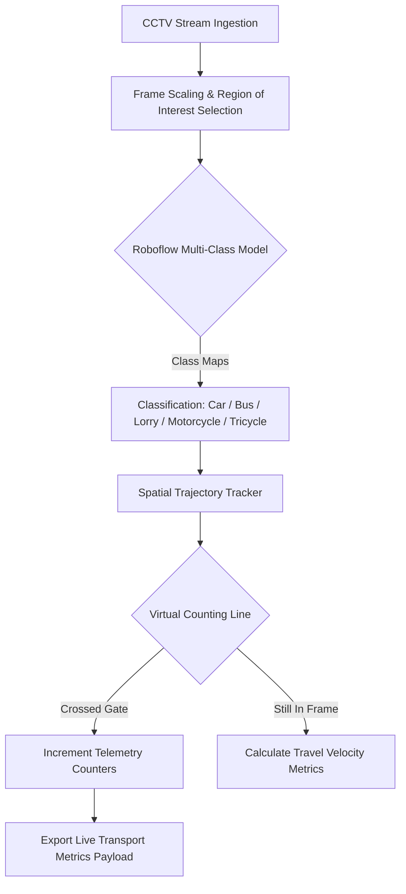

YOLOv8 Object Detection with DeepSORT Tracking - Training Process Explanation
Overview
This notebook implements a complete pipeline for training a custom object detection model using YOLOv8 and integrating it with DeepSORT for multi-object tracking. The workflow is designed for computer vision applications requiring real-time detection and tracking of vehicles and objects.

Step-by-Step Training Process
1. Environment Setup
GPU Configuration: The notebook requires GPU runtime (Tesla T4 in this case) for efficient training

Repository Cloning: Clones the YOLOv8-DeepSORT-Object-Tracking repository from GitHub

Dependency Installation: Installs all required packages using pip install -e '.[dev]'

2. Dataset Acquisition
Roboflow Integration: Downloads a custom dataset from Roboflow (workspace: "drone-dataset-mvh8i", project: "detection-bzujh")

Dataset Format: YOLOv5 format with ~4,051 training images and 619 validation images

Classes Detected: 10 categories including:

boat, camping car, car, motorcycle, other, pickup, plane, tractor, truck, van

3. DeepSORT Setup
Downloads and extracts DeepSORT tracking files including:

Feature extractor model (ckpt.t7)

Kalman filter implementation

Hungarian algorithm for assignment

Configuration files

### System Architecture Flow

---

##  2. Dataset Architecture & Class Engineering (Roboflow)

The machine learning core utilises a highly refined custom model, trained and versioned via **Roboflow**, on a dataset of **852 high-resolution highway images**.

### Targeted Transportation Classes
* **Car**: Standard passenger vehicles and compact personal transports.
* **Bus**: Mass transit and high-capacity multi-passenger vehicles.
* **Lorry**: Light-to-heavy commercial logistics, multi-axle freight carriers, and utility trucks.
* **Motorcycle**: Two-wheeled high-velocity commuters.
* **Tricycle**: Three-wheeled localized urban transport vehicles requiring unique bounding-box aspect ratio tolerances.

### Dataset Management & Optimization Strategies
* **Aspect-Ratio Resilience**: Bounding boxes were meticulously adjusted to prevent small tricycles and motorcycles from being swallowed up or misclassified inside the massive bounding box areas of overlapping commercial lorries.
* **Environmental Augmentations**: Applied exposure adjustments and salt-and-pepper noise injections across the 852 base frames to ensure high classification stability during rain storms, severe highway sun glare, and headlights during night operations.
