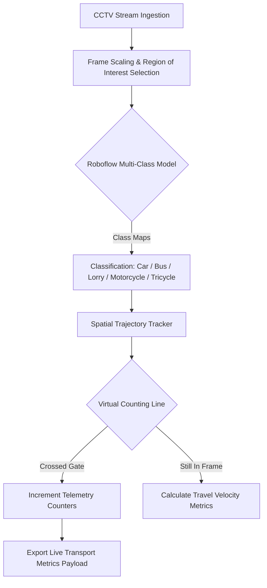

# urban-motorway-traffic-analytics
A multi-class vehicle detection, classification, and trajectory tracking system optimized for urban motorway traffic telemetry using Roboflow and custom spatial filters.

# Urban Motorway Vehicle Detection, Classification & Tracking System

**An enterprise-grade computer vision and traffic intelligence system designed to execute real-time multi-class vehicle localization, classification, and lane-specific trajectory tracking on high-velocity motorways.**

---

> **Portfolio Disclaimer:** This repository serves as a sanitized, public-facing case study and architectural blueprint of a private traffic analytics deployment. To comply with privacy standards, proprietary video datasets, local database configurations, and active Roboflow workspace credentials have been securely omitted.

---

##  1. The Operational Challenge & Core Logic

Managing modern highway traffic networks requires precise, automated asset auditing. Traditional inductive loop detectors embedded in roads are expensive to maintain, easily damaged, and completely unable to categorize vehicles into granular, specific transport groups.

This project solves this bottleneck by turning standard highway CCTV feeds into active telemetry matrices. The system parses frames, handles class variations (such as highly variable logistics patterns between commercial lorries and small tricycles), and generates real-time vehicle flow metrics.

### System Architecture Flow

---

##  2. Dataset Architecture & Class Engineering (Roboflow)

The machine learning core utilizes a highly refined custom model trained and versioned through **Roboflow** across a dataset lifecycle of **852 high-resolution highway images**.

### Targeted Transportation Classes
* **Car**: Standard passenger vehicles and compact personal transports.
* **Bus**: Mass transit and high-capacity multi-passenger vehicles.
* **Lorry**: Light-to-heavy commercial logistics, multi-axle freight carriers, and utility trucks.
* **Motorcycle**: Two-wheeled high-velocity commuters.
* **Tricycle**: Three-wheeled localized urban transport vehicles requiring unique bounding-box aspect ratio tolerances.

### Dataset Management & Optimization Strategies
* **Aspect-Ratio Resilience**: Bounding boxes were meticulously adjusted to prevent small tricycles and motorcycles from being swallowed up or misclassified inside the massive bounding box areas of overlapping commercial lorries.
* **Environmental Augmentations**: Applied exposure adjustments and salt-and-pepper noise injections across the 852 base frames to ensure high classification stability during rain storms, severe highway sun glare, and headlights during night operations.
